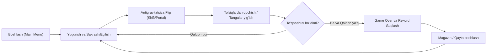

# GAME DESIGN DOCUMENT (GDD)
# PIXEL RUNNER: ANTI-GRAVITY PROTOCOL

**Hujjat Versiyasi:** 2.0  
**Loyiha turi:** 2D Endless Runner / Arcade Capstone  
**Dvigatel:** Godot Engine 4.x (2D)  
**Target Platformalar:** Windows, Web (HTML5), Android  

---

## 1. O‘YIN KONSEPSIYASI VA CORE LOOP

### 1.1. High Concept
"Pixel Runner" — kiberpunk/retro pixel-art estetikasidagi cheksiz yugurish o‘yini. O‘yinning asosiy innovatsion mexanikasi — 180 graduslik **Antigravitatsiya** tizimi. O‘yinchi nafaqat pastdagi polda, balki tavandagi (shift) relslarda ham teskari holatda yugurishi, to‘siqlardan qochishi va bonuslarni yig‘ishi mumkin.

### 1.2. Core Loop

---

## 2. BOSHQARUV TIZIMI (CONTROLS)

| Harakat | Klaviatura | Gamepad (Controller) | Touch / Sensorli |
| :--- | :--- | :--- | :--- |
| **Sakrash (Jump)** | `Space`, `W`, `Up Arrow` | `A` (Button 0), D-pad Up | **JUMP** tugmasi |
| **Egilish / Fast Fall** | `S`, `Down Arrow` | `B` (Button 1), D-pad Down | **SLIDE** tugmasi |
| **Gravitatsiya Flip** | `Shift`, `F` | `Y` (Button 3), `X` (Button 2) | **FLIP GRAVITY** |
| **Pauza (Pause)** | `Escape`, `P` | `Start` (Button 6) | **II** tugmasi |

---

## 3. ASOSIY MEXANIKALAR VA ALGORITMLAR

### 3.1. Antigravitatsiya Mexanikasi
- Oddiy holatda: `gravity.y = 1400.0`, tayanch yuzasi — pastki pol (Y = 580).
- Invert holatda: `gravity.y = -1400.0`, tayanch yuzasi — yuqori shift (Y = 140).
- Qahramon orientatsiyasi: `scale.y = -abs(...)` orqali sprite va qalqon vertikal teskarilanadi.
- Kolliziya va sakrash kuchi avtomatik yangi tayanch yuzasiga moslashtiriladi.

### 3.2. Dinamik Tezlanish Algoritmi
Masofa oshishi bilan o‘yin tezligi formula asosida o‘sadi:
$$\text{speed} = \min\left(\text{base\_speed} + (\text{distance} \times \text{acceleration\_rate}),\ \text{max\_speed}\right)$$
- $\text{base\_speed} = 380.0\ \text{px/s}$
- $\text{acceleration\_rate} = 0.04$
- $\text{max\_speed} = 950.0\ \text{px/s}$

Spawner to‘siqlar orasidagi masofani hisoblaydi:
$$\text{spawn\_interval} = \text{clamp}\left(\frac{\text{base\_gap}}{\text{speed}},\ 0.75,\ 2.0\right)$$

---

## 4. POWER-UP VA VALYUTA BALANSI

1. **Coin (Oltin tanga):** 1 tanga (Double Coin faolligida 2 tanga). Do'konda skinlar sotib olish uchun xizmat qiladi.
2. **Energy Shield:** 1 martalik to‘qnashuvdan 100% himoya qiladi va kamera silkinishi bilan sinadi.
3. **Coin Magnet:** 8 soniya davomida 260px radiusdagi tangalarni o‘yinchiga tortadi.
4. **Gravity Core:** 10 soniya davomida o‘yinchiga istalgan nuqtada gravitatsiyani almashtirish imkonini beradi.
5. **Double Multiplier ($2\times$):** 10 soniya davomida barcha tangalarni 2 baravar oshiradi.

---

## 5. DO‘KON VA PROGRESSIYA

- **Cyber Runner:** Boshlang'ich kiber kostyum (0 tanga).
- **Neon Ninja:** Neon pushti kiber forma (50 tanga).
- **Golden Mech:** Oltin reaktiv zirh (100 tanga).

---

## 6. OVOZ VA AUDIO DIZAYN
- BGM: 126 BPM retro 8-bit chiptune Am-F-C-G akkordlar ketma-ketligi bilan loop.
- SFX: Jump (frequency sweep), Slide (filtered noise), Gravity Flip (dual-phase saw sweep), Coin (chime 987Hz -> 1318Hz), Powerup (4-note arpeggio), Hit (crunchy explosion), Shield Break (glass shatter).
